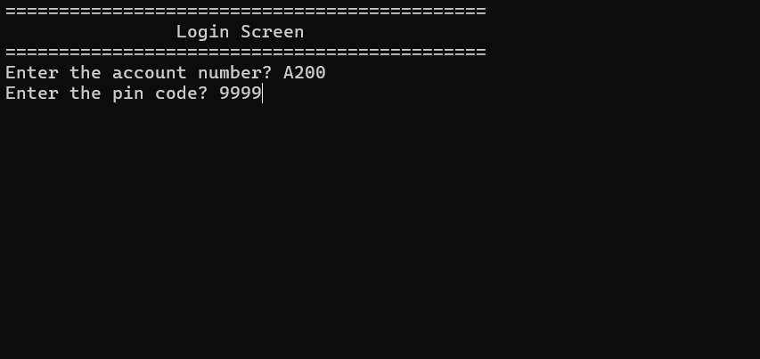
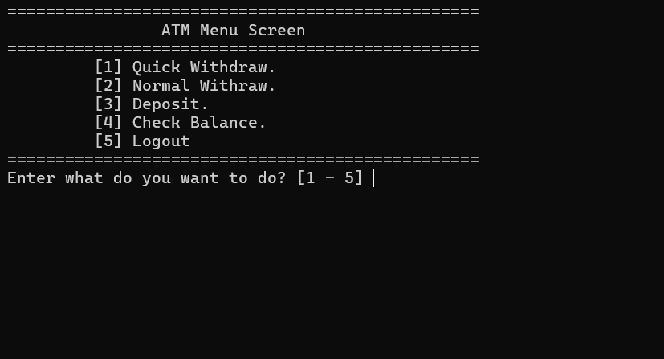
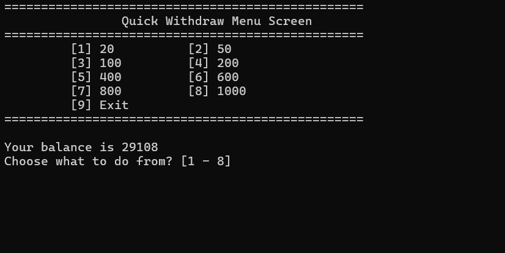
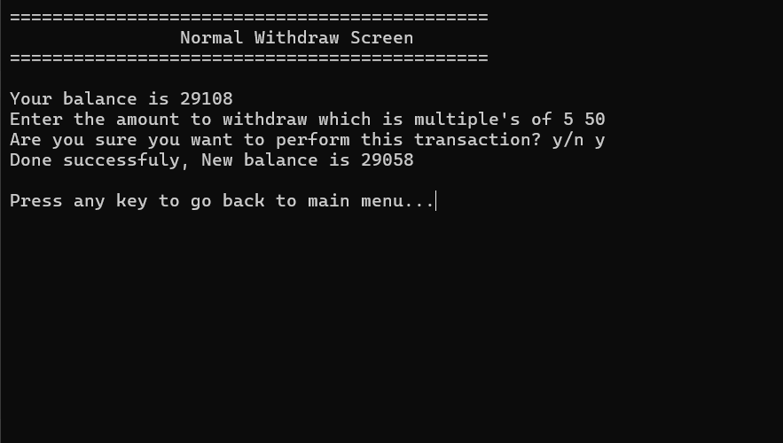
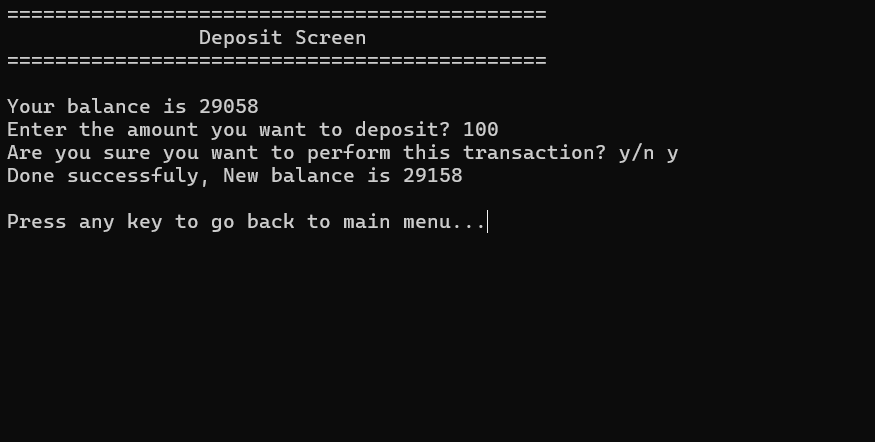
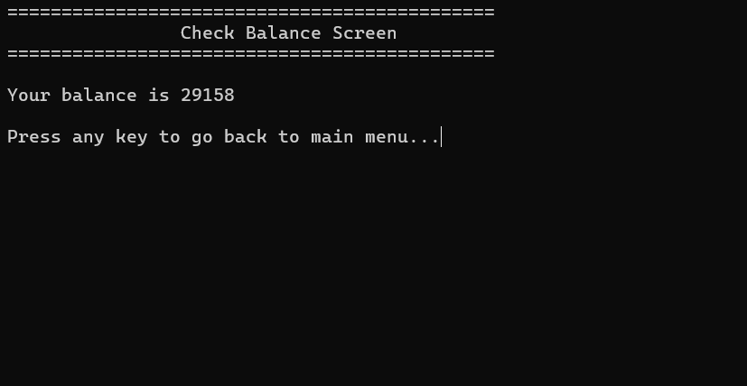

# ATM_system-project
- System that simulates an atm machine, this system stores data in file as a database.
- A client logs in by account number and pin code, Then the ATM menu appears.
- It has 5 options : quick withdraw, normal withdraw, deposit, check balance and log out.
- I created this project to practice functional/procedural programming.

## Photos
- 
- 
- 
- 
- 
- 